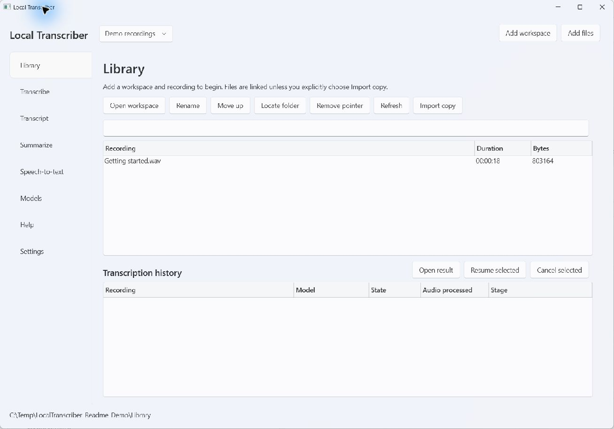
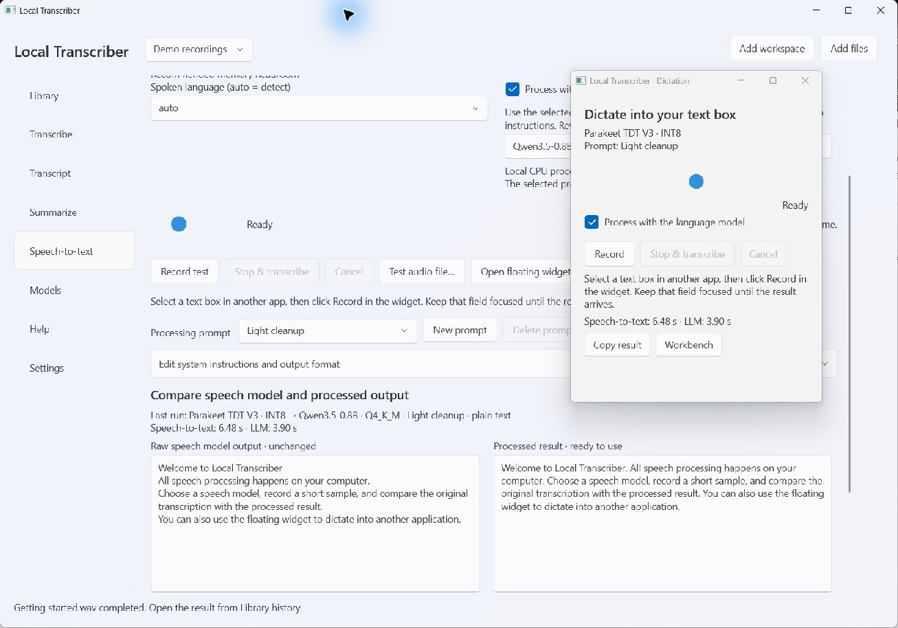

# Local Transcriber

Portable Windows x64 application for local CPU transcription, dictation and summaries. Version 1.2.1.

This repository publishes the functioning prototype's source under GPL-3.0-or-later. Build the portable application with `build.ps1`; generated packages live in ignored `dist/`. No prebuilt binary release is published here. See [test results and remaining acceptance checks](docs/TEST_RESULTS.md) and [third-party redistribution requirements](THIRD_PARTY_NOTICES.md) before distributing a binary bundle.

After building, extract `dist/LocalTranscriber-portable.zip` and launch `LocalTranscriber.exe` inside the `LocalTranscriber` folder. Keep the entire folder together. You do not need Python, FFmpeg, .NET, Visual Studio, Ollama, or a GPU installed. This build requires an AVX2 CPU and a supported Windows desktop environment. Windows 11 is the tested target.

Add a workspace, add recordings, download a speech model from **Models**, then select the recording and **Transcribe**. Open the result from Library history to edit/export. Download an LFM2.5 model for **Summarize**. Model downloads require internet; transcription and summaries use local CPU workers.

Models are stored separately in `%LOCALAPPDATA%/LocalTranscriber/models`. The application starts without loading model weights. Source recordings are never modified. Workspace pointers can be removed without deleting files.

**Speech-to-text** is the microphone and model workbench. Select a microphone and speech model, record a test or compare an existing audio file, and inspect raw, vocabulary-corrected and final text. Open the floating widget to record without taking focus away from another application's text box. Stop transcribes locally and inserts at the original selection if that field is still focused. Optional local LLM cleanup removes fillers and resolves spoken corrections; it defaults off. A configurable vocabulary map also applies to new file transcription jobs. **Help**, immediately above Settings, contains the first-run tutorial and can replay it.

Version 1.2 adds Qwen3.5 0.8B/2B/4B and Gemma 4 E2B/E4B downloads, saved speech-processing prompts with full system overrides and default reset, and a Markdown/plain-text output choice. The workbench compares unchanged raw ASR with processed output side by side, and can reapply a prompt to the same raw speech without repeating ASR. Segment line breaks are removed before vocabulary replacement and optional LLM processing. Separate speech/LLM elapsed times appear in the workbench and widget.

See [User guide](docs/USER_GUIDE.md), [architecture](docs/ARCHITECTURE.md), [decisions](docs/DECISIONS.md), [test results](docs/TEST_RESULTS.md), and [third-party notices](THIRD_PARTY_NOTICES.md).

## Screenshots

These captures use an isolated demo library and synthetic speech. They contain no personal recordings, names, account details or faces.

**Library** — workspace navigation and linked recordings.



**Speech-to-text** — raw and processed results side by side, with the floating dictation widget open. The demo uses Parakeet and Qwen3.5 with the built-in Light cleanup prompt.



## Build

Development requires Windows x64, .NET SDK 10.0.101 or a compatible newer feature band, Python 3.13, and Git. Development-only runtime preparation downloads pinned archives and wheel packages; end users do not perform it.

```powershell
.\build.ps1
.\test.ps1
.\test.ps1 -Smoke
.\test.ps1 -Smoke -Extended
.\test.ps1 -Ui
.\test.ps1 -Dictation
```

`-Smoke` deliberately downloads the specified ASR/LLM models into isolated `test-output/data` storage and runs actual inference. It can take substantial CPU time and several GB of disk. Use `-Asr parakeet-v3-int8,whisper-small -Llm lfm25-1.2b-instruct` for a shorter test. No model weights are embedded in the release ZIP.

`-Dictation` uses Parakeet and Whisper Small installed by `-Smoke` and downloads Qwen2.5 7B-Instruct into isolated test storage if needed. It exercises actual inference/editing, vocabulary rules, tutorial replay, light/dark layouts, real microphone buffers when available, widget clicks, and Unicode/paragraph insertion into a separate process's test text box. It opens temporary test windows on your desktop, so leave them focused while the insertion check runs. It never targets your other applications.

`assets/catalogue.json`, `assets/runtime-lock.json`, the NuGet lockfile and `workers/requirements.lock.txt` pin tested dependencies. `python scripts/catalogue.py` is an **explicit development operation** that refreshes model revisions; inspect its diff and retest before release. The app never performs this operation automatically.

The portable build is a ZIP rather than one monolithic EXE so native libraries, Python isolation, and licence documents remain reliable and inspectable. `LocalTranscriber.exe` itself includes its .NET desktop runtime.

To build a versioned package alongside a running copy, use `build.ps1 -SkipRuntime -OutputName LocalTranscriber-1-2-1` and `test.ps1 -ReleaseName LocalTranscriber-1-2-1` (also with `-Ui` or `-Dictation`). This version's ready-to-launch bundle is `dist/LocalTranscriber-1-2-1-portable.zip`.

Version 1.2.1 fixes the compact models' licence-download source check. Completed, hash-verified weights in staging are reused when retrying; the remaining licence is verified before installation becomes visible.

`tests/clean-machine.ps1` generates a Windows Sandbox configuration with networking and virtual GPU disabled, read-only application/model/fixture mappings, and a dedicated writable evidence directory. Windows Sandbox is not installed on the development host, so that target check still needs to run on an appropriate clean Windows machine.
